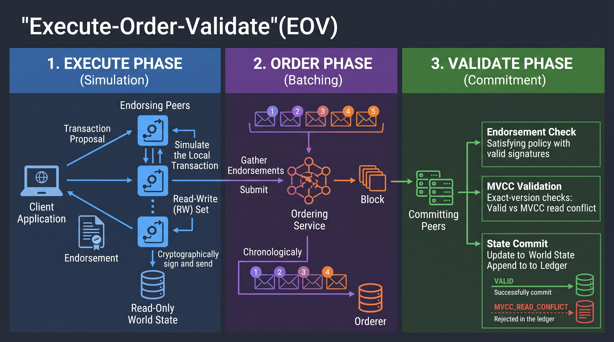

# Mini-Fabric: EOV Consortium Simulator

Mini-Fabric is a runnable Execute-Order-Validate (EOV) blockchain simulator modeling the endorsement policies, ordering service, and MVCC validation semantics of Hyperledger Fabric.

## Architecture Diagram (Execute-Order-Validate)

## Endorsement Policy Grammar
Policies are defined as a tuple: `(n, ["Org1", "Org2", ...])`.
* `n` represents the threshold number of unique organizations required.
* The list contains the acceptable organizations.
* Validation ensures that each endorsement contains a valid ECDSA signature from a unique organization listed in the policy matching the transaction's read-write set.

## MVCC Rules
Multi-Version Concurrency Control (MVCC) ensures strict state consistency.
* During the Execute phase, read operations record the exact version of the key.
* During the Validate phase, the committer checks if the current world state version of every read key exactly matches the recorded read version (`world.get(k)[1] == ver`).
* If the version has incremented (due to another transaction committing first), the transaction fails with `MVCC_READ_CONFLICT` and writes are dropped.

## Private Data Design
To maintain data privacy among consortium members while ensuring ledger integrity:
* **Ledger:** Only the SHA-256 hash of the private data is submitted in the transaction read-write set and committed to the channel ledger.
* **Side Database:** The actual plaintext data is distributed via transient off-ledger storage (side-db) only to authorized members.
* Non-members can cryptographically verify the integrity of the data against the hash on the ledger without being able to read the plaintext.

## Team Roles
* **Protocol Engineer:** Developed peers, chaincode simulation, read-write sets, and MVCC validation.
* **Test & Security Lead:** Built endorsement-policy engine, cryptographic signature checks, and adversarial testing.
* **Frontend/Integration:** Implemented the ordering service, block cutting, channel isolation, CLI, and throughput benchmarks.

## Benchmark Report & Essay
### Benchmark: MVCC Contention vs Throughput
| Hot Key % | Valid | Conflicts | Throughput (TPS) |
|-----------|-------|-----------|------------------|
| 0%        | 1000  | 0         | 8988.69          |
| 10%       | 905   | 95        | 8126.49          |
| 50%       | 495   | 505       | 4446.39          |
| 90%       | 86    | 914       | 775.39           |

### Analysis
The empirical benchmark results demonstrate a severe inverse relationship between state contention and system throughput within an Execute-Order-Validate (EOV) distributed ledger architecture. Under 0% hot-key contention, the simulated network successfully processed all 1,000 transactions, achieving an optimal throughput of 8,988.69 TPS. However, as the probability of transactions targeting a single shared state increased to 90%, valid throughput collapsed to 775.39 TPS, with 914 transactions discarded due to read conflicts.

This systemic degradation is a direct artifact of Hyperledger Fabric's optimistic Multi-Version Concurrency Control (MVCC) mechanism. In the EOV model, endorsing peers simulate transactions in parallel against the current world state, generating read-write sets (rwsets). Crucially, the ordering service then blindly batches these endorsed proposals into blocks without evaluating their underlying logic or data dependencies.

When multiple transactions modify the same key, they are simulated against the identical state version. During the sequential validation phase, the first transaction successfully commits and increments the state version. All subsequent transactions in the block targeting that same key fail the strict MVCC validation (`world.get(k)[1] == ver`) because their read versions no longer match the committed world state. These transactions are permanently marked as `MVCC_READ_CONFLICT`.

From a business informatics perspective, this optimistic concurrency model dictates clear boundaries for enterprise architecture. While EOV allows for massive parallel scaling of disjoint data, applying it to highly centralized data models—such as a single sequential counter in an ERP system or a singular internship registry—creates cascading transaction failures. Because Fabric does not use row-level locking or transaction queuing, the application layer must absorb the cost of detecting conflicts and resubmitting failed transactions, significantly suppressing effective throughput.